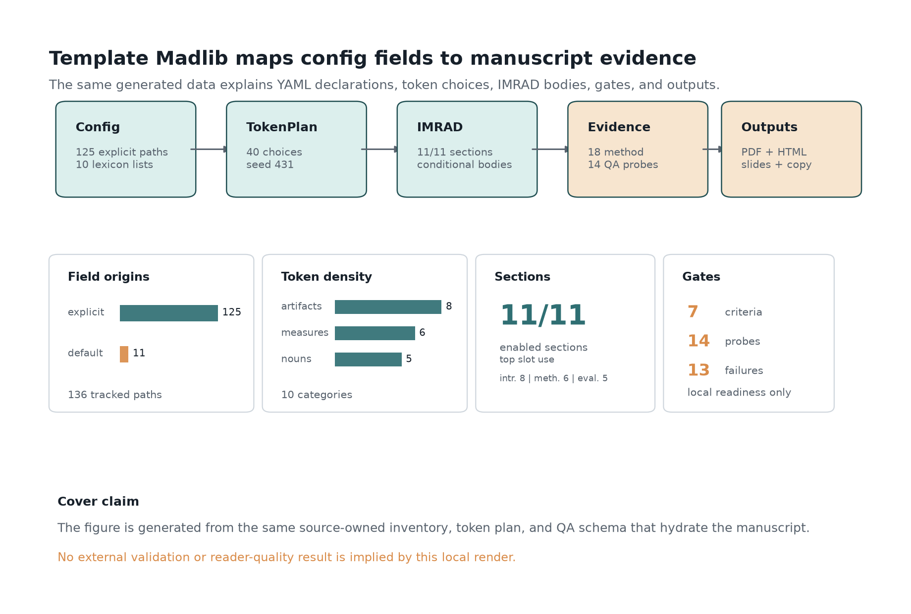

# Template Madlib — Deterministic Token-Injection Exemplar

`template_madlib` is a public canonical exemplar for configuration-driven manuscript generation. It uses a Mad Lib style vocabulary surface, but the point is not novelty prose. The point is to show how conditional text, section titles, method steps, design principles, QA probes, authoring obligations, configured-field origins, token provenance, and publication boundaries can be generated from tracked config plus project-local source code.

`docs/manuscript/config.yaml` owns the `madlib:` schema: seed, lexicon, slots, section switches, section titles, narrative moves, method protocol, design principles, operational phases, evaluation criteria, QA probes, failure modes, authoring obligations, visualization controls, audit rules, and contribution claims. The Python package expands that schema into token choices, configured-field origin inventories, evidence tables, reports, a figure registry, nine generated figure artifacts (the cover overview plus eight interior manuscript figures), and a hydrated IMRAD manuscript under `output/manuscript/`. The current method protocol is intentionally broad: it covers schema ingestion, review-scenario declaration, field-origin tracking, lexicon governance, digest construction, invariant review, slot expansion, section-condition handling, body composition, evidence-table assembly, claim-ledger alignment, figure registry generation, manuscript hydration, render validation, review-packet assembly, copy validation, and fork-migration documentation.

## When to use this template

Use this template when you need **configuration-driven manuscript generation with auditable token provenance, conditional section structure, explicit/default field visibility, failure-boundary reporting, and a reviewer-visible authoring contract**: lexicon categories, section titles, narrative moves, method steps, design principles, pipeline phases, evaluation criteria, QA probes, failure modes, authoring obligations, visualization controls, audit rules, and slots are declared in YAML; `src/` deterministically expands those declarations; and the manuscript receives large-grain `{{TOKEN}}` bodies only after the source code has generated the supporting artifacts. It is not a natural-language quality benchmark or a claim that random word substitution creates scholarship.

- [Documentation](docs/README.md)
- [Quick start and locked tests](docs/quickstart.md)
- [Authoring and review packet](docs/workflow.md)
- [Canonical manuscript and pinned render](docs/manuscript/README.md)

## Publication and rendering

The publishing metadata and per-platform status below are **compiled from
`docs/manuscript/config.yaml`** by `infrastructure.publishing.status_report` — do not
hand-edit between the markers; update the config and regenerate (see the legend).

<!-- PUBLISHING-STATUS:START (generated by infrastructure.publishing.status_report) -->
**Template Madlib: Deterministic Token Injection for Conditional IMRAD Manuscripts** · v0.1.1 · MIT · Daniel Ari Friedman

Concept DOI: [10.5281/zenodo.20786638](https://doi.org/10.5281/zenodo.20786638) | Version DOI: [10.5281/zenodo.20932025](https://zenodo.org/records/20932025) | Repository: [docxology/template_madlib](https://github.com/docxology/template_madlib)

Publishing surface — 20 platforms, 9 published:

| Platform | Tier | Status | Reference | Credentials |
| --- | --- | --- | --- | --- |
| zenodo | first-class | ✅ published | [10.5281/zenodo.20786638](https://doi.org/10.5281/zenodo.20786638) | `ZENODO_API_TOKEN` |
| github | first-class | ✅ published | [docxology/template_madlib](https://github.com/docxology/template_madlib) | `GITHUB_TOKEN` |
| arxiv | first-class | ⚪ available | — | — |
| pypi | first-class | ✅ published | [https://test.pypi.org/project/template-madlib/0.1.1/](https://test.pypi.org/project/template-madlib/0.1.1/) | `PYPI_TOKEN`, `TESTPYPI_TOKEN` |
| ipfs_pinata | first-class | ✅ published | [https://gateway.pinata.cloud/ipfs/QmcrHEuVYorBXHuLXZRjHQQ7kgKnAJx1MvxNpbyZSrvxNQ](https://gateway.pinata.cloud/ipfs/QmcrHEuVYorBXHuLXZRjHQQ7kgKnAJx1MvxNpbyZSrvxNQ) | `PINATA_JWT` |
| ipfs_web3storage | first-class | ⚪ available | — | `WEB3_STORAGE_TOKEN` |
| software_heritage | first-class | ✅ published | [https://archive.softwareheritage.org/browse/origin/?origin_url=https://github.com/docxology/template_madlib](https://archive.softwareheritage.org/browse/origin/?origin_url=https://github.com/docxology/template_madlib) | — |
| github_pages | first-class | ✅ published | [https://docxology.github.io/template_madlib/](https://docxology.github.io/template_madlib/) | `GITHUB_TOKEN` |
| cloudflare_pages | first-class | ⚪ available | — | `CLOUDFLARE_API_TOKEN` |
| netlify | first-class | ✅ published | [https://6a44418df7f6f9fa20037643--tranquil-kleicha-0c9203.netlify.app](https://6a44418df7f6f9fa20037643--tranquil-kleicha-0c9203.netlify.app) | `NETLIFY_AUTH_TOKEN` |
| huggingface_hub | first-class | ✅ published | [https://huggingface.co/datasets/ActiveInference/template_madlib](https://huggingface.co/datasets/ActiveInference/template_madlib) | `HUGGINGFACE_TOKEN`, `HF_TOKEN` |
| osf | first-class | ✅ published | [https://osf.io/ndpue/](https://osf.io/ndpue/) | `OSF_TOKEN` |
| amazon_kdp | documented | 🟡 planned | — | `AMAZON_KDP_EMAIL`, `AMAZON_KDP_PASSWORD` |
| google_play_books | documented | 🟡 planned | — | `GOOGLE_PLAY_BOOKS_SERVICE_ACCOUNT_JSON` |
| gumroad | documented | 🟡 planned | — | `GUMROAD_ACCESS_TOKEN` |
| leanpub | documented | 🟡 planned | — | `LEANPUB_API_KEY` |
| lulu | documented | 🟡 planned | — | `LULU_CLIENT_KEY`, `LULU_CLIENT_SECRET` |
| draft2digital | documented | 🟡 planned | — | `DRAFT2DIGITAL_API_TOKEN` |
| stripe | documented | 🟡 planned | — | `STRIPE_SECRET_KEY`, `STRIPE_PUBLISHABLE_KEY` |
| ingramspark | documented | 🟡 planned | — | `INGRAMSPARK_CLIENT_ID`, `INGRAMSPARK_CLIENT_SECRET` |

_Keywords: madlib generation, token injection, conditional manuscripts, reproducible research, IMRAD._

_Status legend: ✅ published (durable identifier recorded in `config.yaml`) · 🔵 reserved (identifier reserved but not yet registered by final publication) · ⚪ available (adapter implemented and locally verifiable) · 🟡 planned. This block is generated — edit `docs/manuscript/config.yaml`, then regenerate with `uv run python -m infrastructure.publishing.status_report --project <path> --write`._
<!-- PUBLISHING-STATUS:END -->
